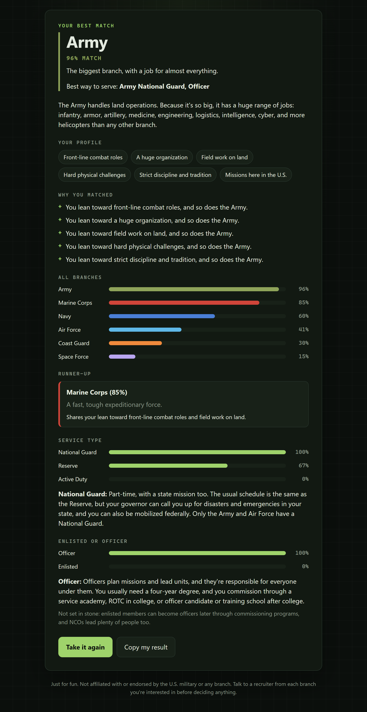

# Ranked Bingo

A quiz that matches you to the U.S. military branch that fits you best (Army, Marine Corps, Navy, Air Force, Space Force or Coast Guard), your top jobs in it, enlisted or officer, and Active Duty, the Reserve or the National Guard.

**Take it:** https://samuelarther.github.io/rankedbingo/

## How it works

- A pool of 101 questions, most of them indirect: weekend trips, game picks, how you handle an order you disagree with, boot camp style, what you want after you get out. Each quiz draws a balanced set: 45 questions in the full quiz or 15 in quick mode, chosen so every trait and job interest is covered. A few key questions are always included.
- Answers are shuffled (except scales like "love it ... hate it"). Any question can be skipped with "None of these fit me".
- No answer points straight at a branch. Each one nudges up to three of 12 traits: sea, land, air, space, physical, tech, discipline, travel, home front, combat, organization size and comfort. Each answer counts relative to the other options in its question, so the way a question is written can't tilt everyone toward one branch, and random clicking averages out to no lean.
- Each branch has a profile on the same traits. The match blends direction (cosine similarity) with closeness, so balanced profiles don't win by default and branches that lean the same way by different amounts (Army vs Marines) can still be told apart.
- Results show your top branch, scores for all six (tap any to see why it ranked there), a trait radar against any branch, your top 3 roles with the civilian careers they lead to, enlisted or officer, and Active Duty, Reserve or National Guard.
- The final pick is always a real option, like "Air National Guard, Enlisted". Only the Army and Air Force have a National Guard, and the Space Force has no separate Reserve, so those cases fall back to the closest option with a note.
- Progress is saved in your browser, so you can close the tab and continue later.

## Sharing

- **Share link:** a link to your result (with your name if you add one). Friends who open it see your full result.
- **Compare:** paste a friend's link (or open theirs after taking the quiz) to see both results side by side.
- **Share image:** a card with your branch photo, the six-branch graph and your reasons, in three formats: long (phone story), wide (desktop) and square (rounded corners).

## Explore

Besides the quiz, the site has:

- **Branches:** a page per branch covering what it does, what life is like, who it fits, and quick facts. A path picker (enlisted or officer, and Active Duty, Reserve or National Guard) explains that path step by step and lists example jobs with their training.
- **Service types:** Active Duty, Reserve and National Guard explained, plus a table of which branch has what.
- **Boot camp & training:** how enlistment works (recruiter, MEPS, boot camp, job training), then each branch's boot camp, job school and officer routes.

Training facts were checked against official branch recruiting and military sites in October 2026. They change over time, so confirm with a recruiter.

Add `?debug` to the URL to see what each answer scores while playtesting.

Plain HTML, CSS and JavaScript with no dependencies, build step or tracking: `index.html`, `css/style.css`, `js/data.js` (content), `js/logic.js` (scoring) and `js/app.js` (pages).

Just for fun. Not affiliated with or endorsed by the U.S. military or any branch. Talk to recruiters before deciding anything.
